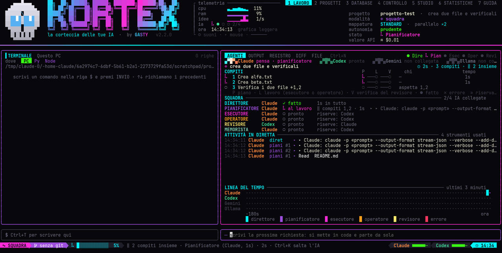
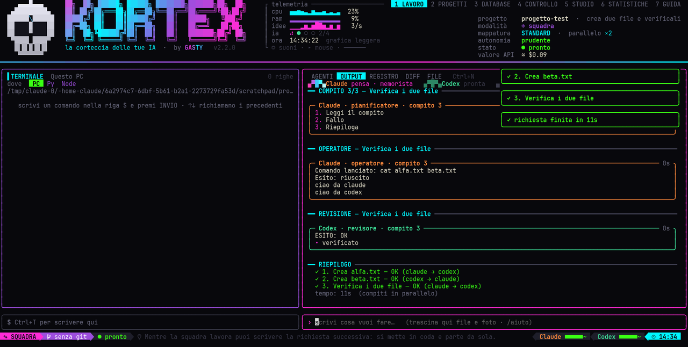
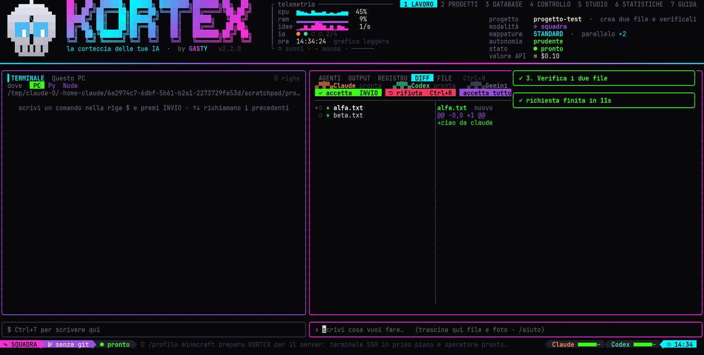
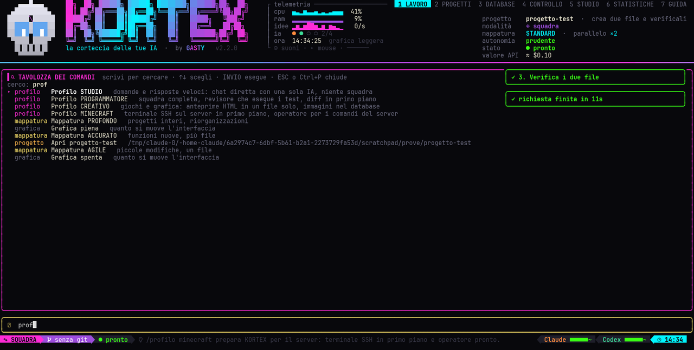
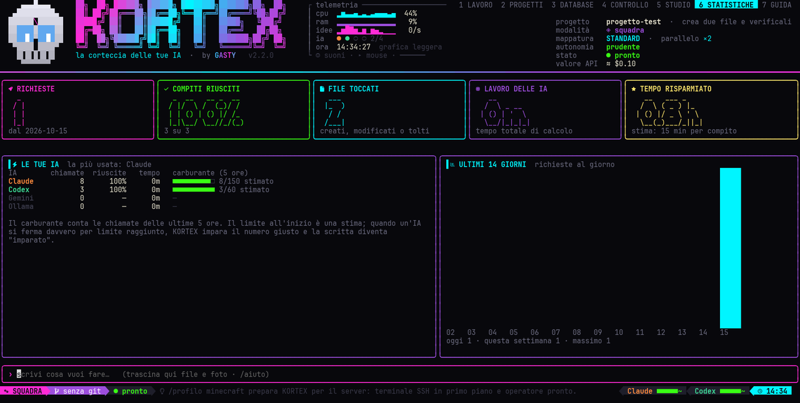

<div align="center">

# KORTEX — la corteccia delle tue IA


*ideato e forgiato da **GASTY***

</div>

## Come si presenta

| AGENTI: la squadra al lavoro | OUTPUT: una bolla per ogni IA |
|---|---|
|  |  |
| **DIFF: revisione file per file** | **Ctrl+P: la tavolozza dei comandi** |
|  |  |



**Novità della 2.2**: tavolozza dei comandi **Ctrl+P**, OUTPUT a **bolle** con testo formattato, **revisione** dei file uno per uno (accetta / riporta com'era), **barra di stato** a blocchi colorati, **carburante** degli abbonamenti nelle ultime 5 ore, **profili** di lavoro (Programmatore, Minecraft, Studio, Creativo), temi **Tokyo Night, Dracula, Synthwave, Vaporwave**, icone **Nerd Font** installate da sole, pagina **STATISTICHE**, giro guidato e finestra delle novità. Tutti i cambiamenti sono in [CHANGELOG.md](CHANGELOG.md).

Un solo comando da terminale che fa lavorare insieme **Claude Code, Codex, Gemini CLI e Ollama** su qualunque progetto. Usa le CLI già installate, quindi i tuoi **abbonamenti**: niente chiavi API, niente costi a consumo. Gira uguale su PC Linux e su Termux (telefono e tablet).

**Novità della 2.0**: compiti in **parallelo**, il ruolo **OPERATORE** che lancia comandi e test al posto tuo, il revisore che **esegue** le verifiche, la **coda** delle richieste, la domanda del direttore con `/chiedi`, il **mouse** (clic e rotella), i **suoni**, la scheda **DIFF**, il **guardiano** del database, le preferenze condivise tra i PC via GitHub, la grafica **piena/leggera** automatica e una schermata iniziale tutta nuova con un **teschio in 3D vero**.

## Installazione

Una riga, su qualunque macchina:

```
curl -fsSL https://raw.githubusercontent.com/davidegastaldo519-creator/kortex/main/get.sh | bash
```

Rilanciare la stessa riga aggiorna all'ultima versione. In alternativa: `kortex --aggiorna`.

Servono **git** e **Node.js 20 o superiore**:

- **Termux:** `pkg install git nodejs`
- **Lubuntu / Ubuntu:**

```
curl -fsSL https://deb.nodesource.com/setup_22.x | sudo -E bash -
```

```
sudo apt install -y nodejs git
```

Poi apri un terminale nuovo e controlla quali IA ha trovato:

```
kortex --check
```

E fai la prova vera: una domanda minuscola a ogni IA, con diagnosi e rimedio se qualcosa non va (login mancante, opzione cambiata, limite raggiunto):

```
kortex --prova
```

### Termux (telefono e tablet)

```
pkg install git nodejs ripgrep
```

```
curl -fsSL https://raw.githubusercontent.com/davidegastaldo519-creator/kortex/main/get.sh | bash
```

Poi `termux-setup-storage` una volta, per vedere foto e download del telefono. Gemini CLI si installa con `npm install -g @google/gemini-cli`, Claude Code con `npm install -g @anthropic-ai/claude-code`. Codex su Termux non è disponibile. Lo schermo piccolo attiva da solo l'impaginazione compatta e il logo corto: meglio in orizzontale.

## La schermata iniziale: il risveglio

All'avvio, circa 12 secondi: il buio, il **battito del cuore** che attraversa lo schermo, le **onde cerebrali**, il **cervello a circuiti** che si accende (diverso a ogni avvio), il **teschio in 3D vero** — calcolato al momento col raymarching, con luce, ombre e le orbite che brillano — che si forma e apre gli occhi, **KORTEX** che si assembla dai frammenti, la firma **forgiata a caldo** (le lettere si raffreddano da incandescenti al colore finale), l'**accensione dei sistemi** con lo stato delle IA, del database e della memoria, e infine il teschio che rimpicciolisce fino all'intestazione mentre le pagine si disegnano. Ogni tema ha la sua scena: stelle (NEON), fiamme (FUOCO), neve (GHIACCIO), pioggia di caratteri (MATRIX). Con i suoni accesi si sentono il battito, il ronzio e il colpo del risveglio.

Si salta con un tasto qualsiasi, o del tutto con `kortex --no-anim`. Sul telefono e nelle finestre piccole parte una versione corta. Su Lubuntu l'icona nel menu e Ctrl+Alt+K aprono il terminale **grande (massimizzato)** ma come finestra normale (serve `wmctrl`: `sudo apt install -y wmctrl`); su Ubuntu/GNOME con Ptyxis la finestra si apre già massimizzata.

## Lo studio: sette pagine

Si passa da una pagina all'altra con **TAB**. ESC riporta sempre a LAVORO.

- **LAVORO** — a sinistra il **terminale** verticale, a destra le **schede** della squadra (Ctrl+N o un clic): AGENTI con l'albero del lavoro, la coda, la mappa dei ruoli e la linea del tempo; OUTPUT a **bolle** con testo formattato; REGISTRO filtrabile (Ctrl+F); **DIFF** per rivedere i file uno per uno (INVIO accetta, Ctrl+R riporta com'era); FILE. Due righe di comando in basso, `$` per il terminale e `›` per le IA, Ctrl+T per passare dall'una all'altra. Mentre la squadra lavora puoi già scrivere la richiesta successiva: si mette in **coda** e parte da sola.
- **PROGETTI** — ogni cartella in cui lavori diventa un progetto con le sue **chat** (come in Claude): le riapri con tutta la storia e la squadra continua da lì. Prima e dopo ogni richiesta KORTEX scatta un **punto di ripristino** in un archivio nascosto separato dal tuo git: `/ripristina ID` riporta tutti i file a quel momento, e anche il ripristino si può annullare. Un nome e INVIO crea un progetto nuovo in `~/kortex-progetti`; `/progetto importa` registra una cartella esistente.
- **DATABASE** — la memoria unica di tutti i progetti (`~/kortex-database`): manuali, codice, documenti, immagini, note. Aggiungi trascinando un file, con `/db aggiungi percorso-o-url` o `/db nota testo`; un'IA **catalogatore** scrive categoria, titolo, descrizione e tag, e tu correggi con `/db sposta`, `/db tag`, `/db titolo`. Il **guardiano** sorveglia la cartella: i file che le IA scrivono lì dentro vengono catalogati da soli. A ogni richiesta KORTEX **cerca da solo** le voci utili e le passa alle IA con percorso ed estratto; `@titolo`, `@ID` o `@manuali` le obbligano a usarne una. `/db github` crea la copia privata su GitHub e da lì KORTEX **sincronizza da solo** in sottofondo (all'avvio, dopo ogni novità, all'uscita); `/db scarica utente` la riporta su un'altra macchina.
- **CONTROLLO** — la plancia: parametri con cursore e spiegazione (anche col mouse: ◂ ▸), 5 mappature in scala crescente, grafici in tempo reale di CPU, RAM e pensieri al secondo, i cervelli e i cavi di ogni IA.
- **STUDIO** — la lavagna col ragionamento dell'ultima richiesta e i tuoi appunti (`/nota`).
- **STATISTICHE** — richieste, compiti riusciti, file toccati, tempo delle IA, tempo risparmiato, carburante di ogni abbonamento e gli ultimi 14 giorni.
- **GUIDA** — il manuale completo.

In qualunque pagina **Ctrl+P** apre la tavolozza: due lettere e trovi pagine, temi, profili, progetti e voci del database. L'ultima riga è la **barra di stato**: modalità e profilo, ramo git, avanzamento, carburante delle IA (stimato all'inizio, poi imparato al primo limite vero), coda e ora.

## Il terminale multi-macchina

Lavora su **questo PC**, sulle **macchine SSH** (quelle già in `~/.ssh/config` compaiono da sole; `/dest aggiungi vps root@indirizzo` ne salva altre) e su **console Python e Node.js** che restano vive tra un comando e l'altro. Ctrl+D cambia macchina, ↑↓ richiamano i comandi precedenti, `cd` si ricorda, Ctrl+C ferma il comando. Per SSH serve una chiave già caricata sulla macchina (`ssh-copy-id`): le password non si possono scrivere qui.

## La memoria

Tre livelli, tutti visibili nella pagina STUDIO: **preferenze** valide in ogni progetto e su ogni PC (`/ricorda`, `/dimentica`: stanno nel database e viaggiano con GitHub), **riassunto del progetto** riscritto dopo ogni richiesta e letto dal direttore, **soluzioni imparate** salvate da sole nel database con il tag `#soluzione`. Le scrive il **memorista**, un'IA che lavora in sottofondo dopo ogni richiesta.

## Grafica, mouse e suoni

Temi **neon, fuoco, ghiaccio, matrix, tokyonight, dracula, synthwave, vaporwave** (`/tema`), il **teschio in 3D** nell'intestazione i cui occhi seguono l'IA che sta pensando, **neuroni** che pulsano negli spazi vuoti, emblemi animati negli angoli di DATABASE (cervello nel barattolo) e PROGETTI (mappa stellare), barra di avanzamento, notifiche a comparsa e di sistema, pannelli che si aprono cambiando pagina. All'avvio KORTEX **misura il PC** e sceglie la grafica **piena** o **leggera** (`/grafica` per forzarla, `kortex --leggera` per una volta).

**Mouse**: clic su pagine, schede, macchine, progetti, chat, voci del database, parametri, mappature, file, opzioni delle domande; rotella per scorrere. Per selezionare testo con il mouse acceso: SHIFT+trascina (oppure `/mouse off`).

**Suoni**: brevi, creati da KORTEX stesso (nessun file da scaricare): battito, ronzio e colpo nella schermata iniziale, una nota per ogni compito finito, un accordo a fine richiesta, un bip per le notifiche. `/suoni off` li spegne. Servono `paplay`, `pw-play`, `aplay`, `play` o `ffplay`; su Termux l'app Termux:API.

Su Lubuntu: **Ctrl+Alt+Shift + frecce** affiancano le finestre a metà schermo, **Ctrl+Alt+Shift+INVIO** massimizza.

## Due modi di lavorare

### Squadra (predefinito)

Scrivi cosa vuoi fare. Dietro le quinte:

1. **Direttore** — divide la richiesta in compiti, per ognuno sceglie chi lo fa e dice quali compiti dipendono da quali
2. **Pianificatore** — scrive un piano a passi (legge i file, non li modifica)
3. **Esecutore** — fa il lavoro sui file del progetto
4. **Operatore** — lancia comandi, test, script e installazioni dentro la cartella del progetto e riferisce: il direttore non chiede mai a te di eseguire qualcosa
5. **Revisore** — controlla, e può lanciare i test per verificare davvero; se trova problemi concreti, chi ha lavorato corregge

I compiti indipendenti partono **in parallelo** (parametro *Compiti in parallelo*, da 1 a 4): due file scritti insieme da due IA, poi i test quando entrambi hanno finito. Con `/chiedi` davanti alla richiesta il direttore può farti **una domanda** a risposta multipla prima di partire.

### Chat diretta

`/chat claude` (o `codex`, `gemini`, `ollama`) e parli con una sola IA, come se la usassi da sola. Ricorda la conversazione anche se chiudi e riapri KORTEX. `/nuova` ricomincia da zero, `/team` torna alla squadra.

## Le regole del motore

- **Le correzioni riprendono la stessa sessione** e ricevono solo le note del revisore, mai il prompt intero da capo
- **Il revisore non può bocciare per ciò che non riesce a vedere**: segnala solo errori concreti
- **A controllare è un'IA diversa** da quella che ha fatto il lavoro, quando possibile
- **Al massimo una correzione** per compito: niente giri infiniti
- **Riserva automatica**: se un'IA finisce il limite dell'abbonamento, passa da sola alla successiva
- **Memoria di progetto**: la cartella `.kortex/` contiene `STATO.md`, il diario del lavoro fatto, che il direttore legge a ogni richiesta. Aggiungila al `.gitignore`

## Uso

Sul PC l'installazione aggiunge anche l'icona **KORTEX** nel menu (categoria Sviluppo) e la scorciatoia **Ctrl+Alt+K** (su Lubuntu/Openbox e su Ubuntu/GNOME, dove viene aggiunta come scorciatoia personalizzata senza toccare le tue): aprono KORTEX nella cartella `~/progetti`, pensata per i lavori nuovi. Il terminale viene scelto da solo: Ptyxis, qterminal, GNOME Terminal o Konsole.

Per lavorare su un progetto esistente, entra nella sua cartella:

```
kortex
```

| Comando | Cosa fa |
|---|---|
| `/chat X` | chat diretta con una sola IA |
| `/allega [file]` | selettore file da allegare, o allega il file indicato |
| `/allegati` · `/togli N` | elenca o toglie gli allegati |
| `/screenshot` | come Ctrl+O |
| `/mappa N` | applica la mappatura da 1 (LAMPO) a 5 (PROFONDO) |
| `/nota testo` | scrive un appunto sulla lavagna dello STUDIO |
| `/pagina N` | va alla pagina da 1 a 4 |
| `/scheda N` | scheda a destra da 1 a 5 |
| `/chiedi richiesta` | il direttore può farti una domanda prima di partire |
| `/coda` · `/coda svuota` | le richieste in attesa |
| `/grafica auto\|piena\|leggera\|spenta` | la grafica |
| `/suoni on\|off` · `/mouse on\|off` | suoni e mouse |
| `/dest` | macchine del terminale: elenca, sceglie, aggiunge |
| `/progetto` | elenca, `nuovo`, `apri N`, `importa percorso`, `qui` |
| `/chat nuova` · `/chat apri N` | chat del progetto aperto |
| `/ripristina [ID]` | punti di ripristino |
| `/db` | database: aggiungi, nota, cerca, sposta, tag, togli, github, sync, scansiona |
| `/tema nome` | neon, fuoco, ghiaccio, matrix, tokyonight, dracula, synthwave, vaporwave |
| `/profilo nome` | programmatore, minecraft, studio, creativo |
| `/statistiche` | apre la pagina STATISTICHE |
| `/bolle on\|off` · `/icone auto\|on\|off` | OUTPUT a bolle · icone Nerd Font |
| `/novita` · `/tutorial` | novità della versione · giro guidato |
| `/ricorda` · `/dimentica N` · `/memoria` | la memoria |
| `/team` | torna alla squadra |
| `/nuova` | in chat diretta, ricomincia la conversazione |
| `/ia` | quali IA sono installate e attive |
| `/ruoli` | chi fa cosa, in ordine di riserva |
| `/stato` | diario del progetto |
| `/config` | dove sta la configurazione |
| `/pulisci` | svuota il pannello OUTPUT |
| `/esci` o Ctrl+C | esce |

Da riga di comando: `kortex --check`, `kortex --prova`, `kortex --no-anim`, `kortex --leggera`, `kortex --aggiorna`, `kortex --versione`.

**Il numero in dollari in alto non è una spesa.** Claude Code riporta quanto costerebbe il lavoro a prezzi API, anche quando usi l'abbonamento a prezzo fisso. Pagheresti davvero solo se sul computer fosse impostata una chiave API (`ANTHROPIC_API_KEY`).

## Autonomia

In `~/.config/kortex/config.json`, la voce `"autonomia"`:

- **`prudente`** (predefinita) — l'esecutore modifica file ma non lancia comandi; i comandi li lancia l'**operatore**, solo dentro la cartella del progetto (profilo `operatore`)
- **`totale`** — le IA fanno tutto senza chiedere, comandi compresi. Solo in cartelle di progetto e con un backup aggiornato

Direttore e pianificatore sono sempre in sola lettura; il revisore può eseguire comandi di verifica (profilo `verifica`), mai modificare file.

## Personalizzare

Tutto in `~/.config/kortex/config.json`:

- `brand` — nome, frase e colori del gradiente
- `ruoli` — per ogni ruolo (direttore, pianificatore, esecutore, operatore, revisore, catalogatore, memorista) le IA in ordine di preferenza: la prima è la titolare, le altre le riserve
- `parallelo` — quanti compiti insieme (1-4); `grafica`, `suoni`, `mouse` — come dalla plancia
- `ia.<nome>.args` — i comandi esatti lanciati per ogni CLI. Se una CLI cambia le sue opzioni con un aggiornamento, si corregge qui senza toccare il codice

## Limiti noti

- Gemini e Ollama non sono esecutori in modalità prudente (non possono scrivere file)
- Codex, Gemini e Ollama non riprendono la sessione: nella chat diretta ricevono gli ultimi 6 scambi
- Il revisore vede tutto il `git diff`: conviene partire con le modifiche precedenti già in un commit
